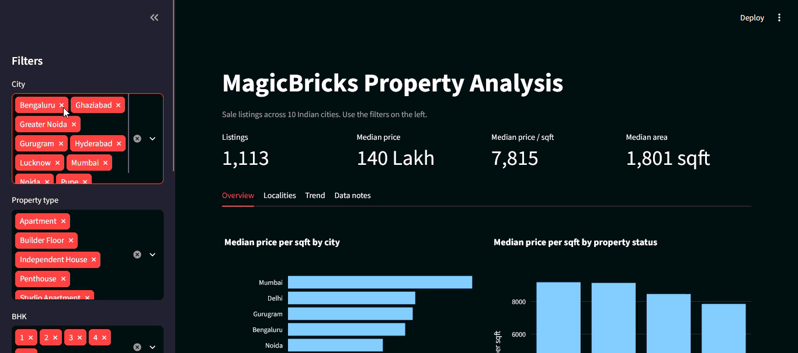
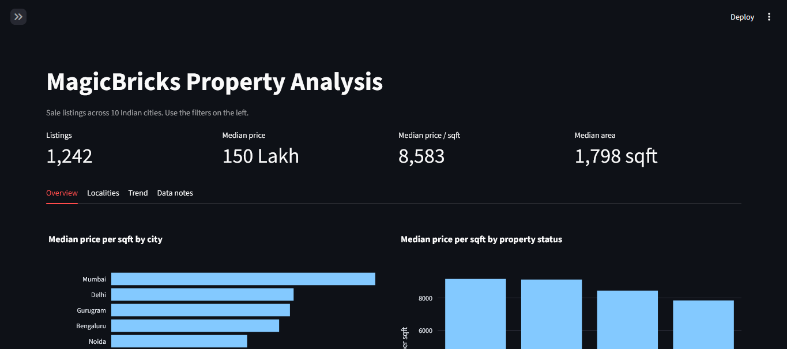
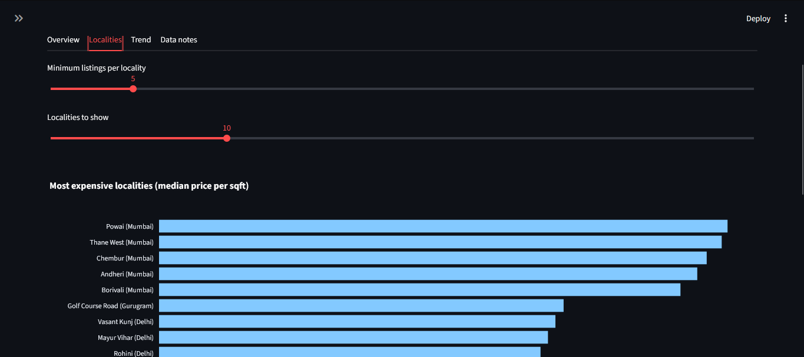

# MagicBricks Property Analysis

End-to-end analysis of 1,820 Indian property listings: raw messy CSV, cleaning pipeline, DuckDB database, SQL analysis and an interactive Streamlit dashboard.



## Key findings

Based on 1,250 sale listings across 10 cities (outliers excluded).

- **City is the biggest price driver.** Median price per sqft ranges from about 16,200 in Mumbai to about 4,100 in Lucknow, roughly 4x. Cities fall into clear tiers: Mumbai, then Delhi, Gurugram and Bengaluru, then Noida, Pune and Hyderabad, then Greater Noida, Ghaziabad and Lucknow.
- **Locality adds little inside a city.** The most expensive localities are simply the localities of the most expensive cities. Within Mumbai the top 5 sit in a tight 15,400 to 16,700 band.
- **Ready to Move and Resale cost about 17% more per sqft** than New Launch (about 9,150 vs 7,830).
- **No clear effect** was found for BHK, distance from the city center, who posted the listing, or amenities. Differences were small and inconsistent, so I did not report them as findings.

## Data quality issues found

| Issue | How it was handled |
|---|---|
| 20 duplicate rows | Removed |
| 15 rows with no price, 8 prices stored as text like `₹120.58 Lakh` | Text cleaned to numbers, empty ones removed |
| 8 impossible areas (50 sqft, 25,000 sqft) | Removed (kept 200 to 10,000 sqft) |
| Inconsistent spelling (`DELHI`, `fully furnished`) | Standardized |
| Impossible BHK and bathroom values (-1 bathrooms, 10 BHK) | Set to missing, row kept |
| Sale and rent mixed in one column with different units | Split into separate columns |
| 11 price outliers | Flagged, hidden by default in the dashboard |

**Limitation:** every rent price in the source file is exactly 5,000 per month, so the rent listings carry no information. They are kept in the database but excluded from the analysis.

## Pipeline

```
raw CSV  ->  clean.py  ->  clean CSV  ->  load_db.py  ->  DuckDB  ->  SQL queries  ->  Streamlit dashboard
```

## Dashboard

- Filters: city, property type, BHK, status, furnishing, price range, outlier toggle
- KPI cards that update with the filters
- Tabs: Overview, Localities, Trend, Data notes

| Overview | Localities |
|---|---|
|  |  |

## Tech stack

Python, Pandas, DuckDB, SQL, Streamlit, Plotly

## Project structure

```
magicbricks-analysis/
  app/dashboard.py          Streamlit dashboard
  data/raw/                 original CSV (never edited)
  data/clean/               cleaned CSVs
  sql/queries.sql           analysis questions
  src/clean.py              cleaning pipeline
  src/load_db.py            loads clean data into DuckDB
  src/run_queries.py        runs all SQL queries
  requirements.txt
```

## Run it yourself

```bash
git clone https://github.com/LoG1604/magicbricks-analysis.git
cd magicbricks-analysis
python -m venv venv
venv\Scripts\activate          # Windows
pip install -r requirements.txt

python src/clean.py
python src/load_db.py
python src/run_queries.py
streamlit run app/dashboard.py
```

## What I would do next

- Add a Power BI version of the dashboard
- Try a simple price prediction model and explain which features matter
- Test the findings on a larger, real-world dataset

## Contact

[LinkedIn](https://linkedin.com/in/lakshay-gupta-17b7ba244) | [Portfolio](https://lakshaygupta-portfolio-7.vercel.app)